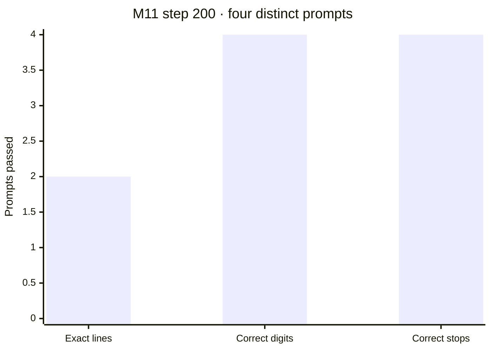
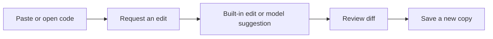

# Plex · Master development roadmap

**November 20, 2026 · Active direction: improve the local coding assistant with the existing checkpoint.**

Plex works on code supplied by the user. The immediate goal is a correct, reviewable edit from an ordinary-language request. Both Plex model lines began with random weights. The 27M Nano is the controlled research baseline. The assistant uses the separate Plex 600M M11 step-200 checkpoint for local model suggestions. Built-in edits run in Python. [Model origins](README.md#origins) Training is paused at the owner's direction. The planned work below uses application changes and inference-only comparisons.

## Measured starting point

Both decoders agreed. The checkpoint copied the two training lines exactly. Both development prompts used the correct digit and ended cleanly, but generated `score` in place of `value`.

At steps 100 and 200, both decoders passed the training pair, and the digit preference test passed on both splits with a gold answer prefix. The development pair failed autonomous exact copying at both milestones. The local run completed 200 updates in 88.051 seconds with 10,708,058,112 CUDA reserved bytes at peak. Evidence comes from the owner's worker summary and eight step-200 generations. The repaired worker ran from commit `89998f5f`. [Worker repair](https://github.com/keepithandy/plex-nano/pull/218)

The console already supports paste, opening a supplied file, bounded rename and text replacement, undo, diff, and saving a new copy. You verified the two-line rename and diff. An earlier console version sent a free-form rename to the checkpoint and received empty text at EOS. The current console labels built-in edits and identifies the checkpoint when it generates a suggestion. [Local console](scripts/PlexLocal.py)

## Phase 0 · Consolidate the baseline · complete

- Record the checkpoint digest, tokenizer identity, worker commit, four milestone decisions, and eight final generations in the experiment evidence.
- Reconcile the repaired worker with the repository release process. Tie the tested console revision to reproducible installation instructions.
- Freeze a small development smoke test with the existing M11 pairs and demonstrated console edit. Record assistant and raw checkpoint results separately.

**Exit gate.** A clean installation reproduces the documented console example and identifies the checkpoint used for any model suggestion.

The clean Windows installation passed all five editor cases. The owner verified the WSL checkpoint path, and the repaired worker is on master. [Phase 0 evidence and reproduction steps](docs/PLEX_PHASE_0_BASELINE.md)

## Phase 1 · Make supplied-file editing dependable · complete

- Exercise paste, UTF-8 file open, exact copy, simple edits, undo, diff, and exclusive save with real JavaScript snippets. Cover CRLF, a trailing newline, quoted text, ambiguous references, conflicts, and unsupported syntax.
- Keep explicit file selection and review. Display the changed spans and any reason an edit cannot be verified.
- Reuse a parser or language service before broadening identifier renames to nested scope or arbitrary JavaScript.

**Exit gate.** End-to-end tests demonstrate original-file preservation and correct edits across supported inputs, including deliberate refusal cases.

Run the [Phase 1 console smoke test](scripts/plex_phase1_smoke.py) with `python -I -S scripts/plex_phase1_smoke.py -v`. The suite checks saved bytes and the original file alongside console output. It runs on Windows and Linux in CI.

**Closure evidence:** The editor audit passed nine end-to-end cases on Windows and Ubuntu, the frozen Phase 0 smoke, and the installed `plex` dashboard package smoke. The tests cover malformed requests, non-UTF-8-surrogate replacements, and protection against switching away from unsaved edits, in addition to the cases above. These are **built-in editor** outcomes; the M11 checkpoint has not demonstrated dependable autonomous edits. [Phase 1 audit and limitations](docs/PLEX_PHASE_1_AUDIT.md) · [Audit changes](https://github.com/keepithandy/plex-nano/pull/227)

## Phase 2 · Turn ordinary language into verified edits · in progress

- Freeze a development set of user requests and expected changes, including paraphrases, ambiguous targets, and requests outside the editor's supported operations.
- Compare the existing checkpoint prompt against inference-only alternatives. Measure empty EOS, exact edits, collateral changes, correct refusal, and latency. Attribute each outcome to the checkpoint or built-in editor.
- Define a minimal structured request for the existing editor and validate the target and intended change against the supplied source before showing a proposal.
- Keep model suggestions reviewable. Handle empty or incomplete outputs explicitly.

**Exit gate.** A fixed, independently scored set demonstrates correct reviewable edits from paraphrased requests. Publish the sample count and raw-model and end-to-end scores.

**Progress:** The first development set contains 33 supplied-JavaScript cases (20 edits/copies and 13 deliberate refusals). A bounded built-in interpreter routes paraphrases through the existing verifier; the read-only scorecard keeps editor and raw-model results separate and reports **not run** without real model output. Windows and Linux CI exercise the console and scorecard. [Plain-language Phase 2 status](docs/PLEX_PHASE_2_START.md) · [Development scorer](scripts/plex_phase2_eval.py) · [Opt-in raw checkpoint comparison](scripts/plex_phase2_infer.py). A local Nov 20 Phase 2 run has now measured 66/66 immediate EOS generations (33 baseline and 33 alternative), 0/20 raw exact edits and 0/13 raw explicit refusals in each format; the built-in editor still passes 20/20 and 13/13. [User-facing result and EOS diagnostic](docs/PLEX_PHASE_2_START.md). The M11 familiar-prompt diagnostic **has now completed** on the owner's GPU: the original prompt copied 2/2 familiar training lines but 0/2 unseen lines; moving its final space to a newline or using the general console format caused immediate EOS on all 8 altered-prompt cases. No new model learning has been demonstrated. **Next:** read-only audit of the existing first-token evidence, followed by the [M12 research-only plan](docs/PLEX_M11_FINAL_INVESTIGATION_M12_PLAN.md). Phase 2's exit gate remains **open** until independently demonstrated raw-model edits and accurate final reporting. Training is still paused.

## Phase 3 · Stabilize local inference and review

- Verify checkpoint and tokenizer compatibility before generation. Report model identity, actual decoding settings, termination reason, context budget, and elapsed time.
- Measure cold and warm latency before choosing a persistent process or other performance work.
- Show a diff before accepting a model proposal. Add syntax validation for supported JavaScript and keep generated code execution out of the default review flow.

**Exit gate.** The normal local workflow handles success, empty EOS, truncated output, invalid code, and repeat requests predictably.

## Phase 4 · Evaluate and package a usable preview

- Run an independent set of supplied-file tasks with exact-edit, syntax, preservation, and refusal scoring. Publish environment details, run commands, known limits, and checkpoint provenance.
- Check install, restart, file review, and save behavior on Windows with the documented WSL setup.
- Choose release claims from measured behavior. Historical draft targets of 95% exact copying and 80% controlled edits on separate locked suites of at least 100 cases remain candidate release targets.

**Exit gate.** A fresh installation can complete the documented supported tasks with measured results and clear attribution.

## Phase 5 · Expand the assistant from measured use

- Add new edit types where development evidence shows demand and the editor can verify the scope. Treat HTML and CSS as distinct evaluation surfaces.
- Review multi-file support around explicitly supplied files once the single-file workflow is dependable.
- Keep changes to model weights, tokenizer, datasets, and training schedules outside this execution plan while training is paused.

**Exit gate.** Each new capability has independent examples, an error path the user can understand, and measured preservation of unrelated code.

## Historical evidence

The 27M Phase 2 closeout recorded 0/18 final semantic passes. Its Phase 3 replacement run recorded 0/36 exact edits. A separate Phase 3 copy-fidelity evaluation scored 0/138 exact files. These are separate evaluations with distinct checkpoints and inputs. [Phase 2 closeout](docs/PHASE-2-P2-50-CLOSEOUT.md) · [Phase 3 investigation](https://github.com/keepithandy/plex-nano/issues/189) · [Pre-consolidation documents](https://github.com/keepithandy/plex-nano/tree/94fed536b9661511c312a2640dc58962096380b0)
