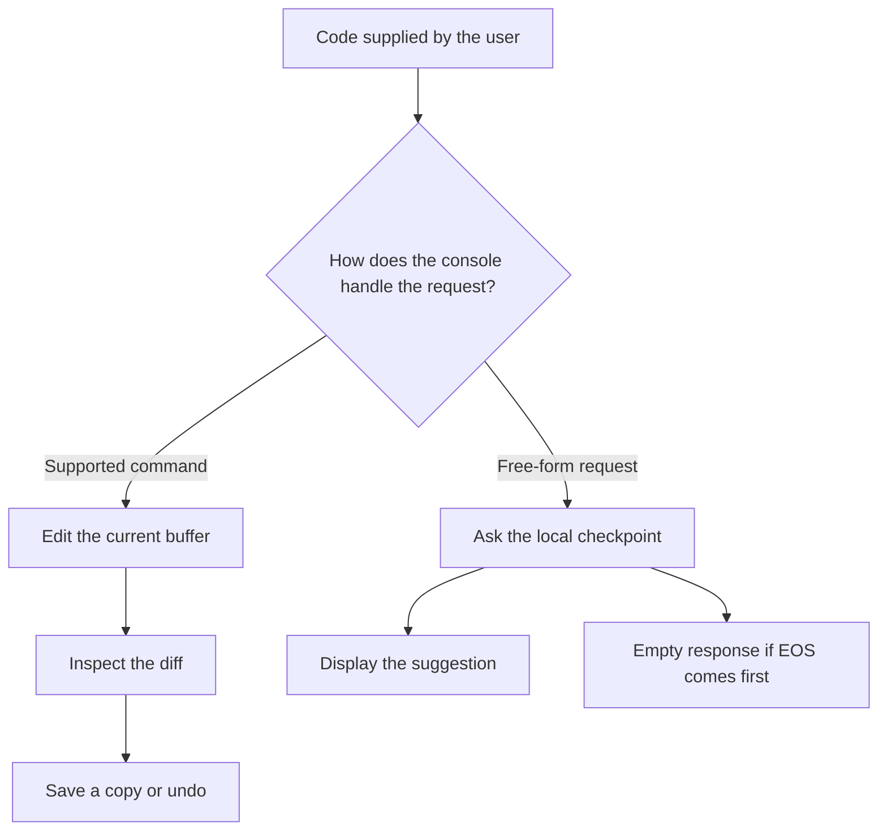
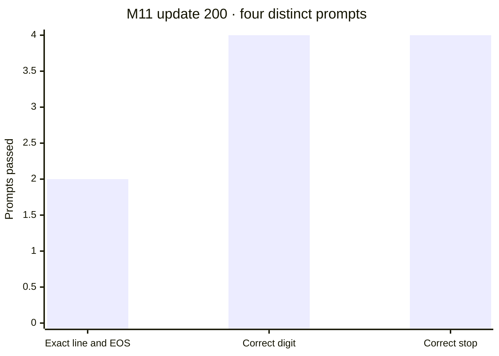

<a id="top"></a>

<p align="center">
  
</p>

<div align="center">

# Plex · Coding models trained from scratch

**Plex starts with random model weights. Its local coding console lets you try the trained checkpoint on code you supply.**

[](#console)
[](#nano)
[](#m11)


[](LICENSE)

[Model origins](#origins) · [Try the console](#console) · [Read the M11 results](#m11) · [Trace the 600M experiments](#research) · [Explore Plex Nano](#nano) · [Find your way around](#guide)

</div>

---

<a id="origins"></a>

## 🧬 Where the weights come from

**Both Plex models began with randomly initialized weights.** The team implemented the models in PyTorch and trained its own weights. Neither track imports pretrained weights from Qwen, GPT, or another base model. “From scratch” describes the origin of the weights. Plex uses established Transformer designs, PyTorch, and a byte-level BPE tokenizer fitted on project data. [Training workspace](training/README.md) · [600M architecture](docs/PLEX-600M-ARCHITECTURE-REVIEW.md)

| What you’re using | Where its behavior comes from |
|---|---|
| **Plex Nano · 27,566,080 parameters** | The original scratch-trained research baseline for HTML, CSS, and JavaScript. It has its own weights and tokenizer. [Model implementation](training/src/plex_training/model.py) |
| **Plex 600M · 600,372,480 parameters** | A separate model initialized for Plex’s M7 run. M9 continued from Plex M7 weights. The M11 run started from Plex M9 weights with a fresh optimizer. The console uses the M11 step-200 checkpoint for suggestions. [M7 initialization](training/src/plex_training/plex600_m7.py) · [M9 checkpoint lineage](docs/PLEX-600M-M9-BOUNDED-EDIT-FINETUNE-2026-11-16.md) · [M11 run receipt](#m11) |
| **Local console · built-in commands** | Python handles supported rename, set, and replace commands directly. A successful built-in edit counts as an editor result. Free-form requests outside those rules can invoke the local 600M checkpoint. |

**Evidence you can inspect.** The model definitions, training procedures, and evaluation protocols are in this repository. The reported M11 measurements come from the owner’s local run. The console checks the local checkpoint against the recorded SHA-256 before inference. The checkpoint bytes are required to independently reproduce the generations. [Four-prompt results and checkpoint digest](#m11)

> [!IMPORTANT]
> The working JavaScript rename came from the console’s built-in editor. The M11 checkpoint learned to copy two familiar lines and stop cleanly. When asked to copy the same lines with a different variable name, it kept the familiar name both times. That distinction guides the [master development roadmap](PLEX-MASTER-ROADMAP.md).

<a id="console"></a>

## 💻 Try the local console

Launch the installed `plex` command to open the dashboard. From a source checkout, run `npm ci`, `npm run build`, then `npm start`, or open it directly with `python scripts/PlexLocal.py`. The dashboard ships in the package and uses Python 3.12 on the tested Windows setup. Type `/clear` to redraw it, `/status` to inspect your session, or `/exit` to quit. Model suggestions use the owner's WSL environment and saved M11 weights. [Dashboard source](scripts/PlexLocal.py) · [Phase 0 smoke test](docs/PLEX_PHASE_0_BASELINE.md)

Enter these lines at the Plex prompt. The line containing only `.end` finishes the paste.

```text
paste
let value = 1;
console.log("value", value);
.end
rename value to count
diff
```

The owner’s session produced this diff. The identifier changes at its declaration and its use. The quoted label stays intact.

```diff
-let value = 1;
-console.log("value", value);
+let count = 1;
+console.log("value", count);
```

| At the prompt | What happens |
|---|---|
| `paste` or `open` with a supplied file | Load the code to edit. Use paste mode for multiline code. |
| `rename value to count` | Apply the built-in identifier rename to a supported snippet. |
| `replace "value" with "count"` | Request a literal text replacement. Use `rename` when a quoted label should survive. |
| `show` · `diff` · `undo` | Inspect the buffer, compare it with the supplied code, or reverse an edit. |
| `save as "plex-demo.js"` | Create a new copy at an unused path. |
| `discard` | Explicitly revert in-memory edits without changing the original file. |

Each successful open or paste starts a new editing session. If the buffer has unsaved edits, Plex refuses to switch sources until you save a new copy or explicitly use `discard`. Verified edits show their changed ranges in the pre-edit buffer.

**Phase 2 has started:** the editor also understands a few bounded paraphrases such as `Change the variable value to count`, `Call this variable count instead`, or `Make value equal to 3`. These are **built-in interpretations**, not Plex 600M model achievements. The [33-case development scorecard](docs/PLEX_PHASE_2_START.md) reports editor results separately from raw checkpoint results, which remain unmeasured until a new inference-only run. The built-in rename checks flat integer declarations and simple `console.log` calls. It explains refusals for cases such as duplicate declarations, conflicting names, or nested syntax. Use `diff` to review and `undo` to restore the previous buffer before saving a copy. Opened UTF-8 files retain their BOM and line endings in saved copies unless the requested edit changes that text. [File editing smoke test](scripts/plex_phase1_smoke.py)

In an earlier console version, “Rename value to count and keep its value at 1.” reached the checkpoint and returned EOS (end of sequence) with an empty suggestion. The current console recognizes that wording for supported snippets and prints `Built-in Python edit applied.` Requests routed to inference display `Generating locally with Plex 600M M11 step 200...`. Empty responses are reported explicitly. Incomplete `rename`, `set`, and `replace` command forms refuse rather than silently invoke the checkpoint; these safeguards are editor behavior, not improved M11 model performance.



<a id="m11"></a>

## 🔬 M11 · What did the checkpoint actually copy?

The test changes one thing at a time. Both training lines use `score`, with either `0` or `1`. The two visible development probes use `value` with the same digits. Each expected answer includes the final newline. The model has to generate the line from the prompt and then emit EOS. Each of the four prompts runs through both the unrestricted and fitted-vocabulary decoders. [Four-case protocol](docs/PLEX-600M-M11-M9-READ-ONLY-BASELINE.md)

| Split | Expected line | Generated at update 200 | Exact line + EOS |
|---|---|---|:---:|
| Training | `let score = 0;` | `let score = 0;` | ✅ |
| Training | `let score = 1;` | `let score = 1;` | ✅ |
| Development only | `let value = 0;` | `let score = 0;` | ❌ |
| Development only | `let value = 1;` | `let score = 1;` | ❌ |

Both decoders gave the outputs shown above. All eight records include the final newline and report EOS. The chart counts each prompt once. [Recorded run summary](PLEX-MASTER-ROADMAP.md#measured-starting-point)



### When did the behavior change?

The original M9 checkpoint hit the 96-token cap on **8/8 generations** under this protocol. The M11 worker measured the following gates during the completed run. A pair passes exact copying only when both lines match and terminate under both decoders. A failed pair alone does not give an individual-case count. [Starting checkpoint evidence](docs/PLEX-600M-M11-BOUNDED-WORKER.md)

| Optimizer update | Training pair exact + EOS | Development pair exact + EOS | Digit preference in both directions on both splits |
|---:|:---:|:---:|:---:|
| 25 | Fail | Fail | Fail |
| 50 | Fail | Fail | Fail |
| 100 | Pass | Fail | Pass |
| 200 | Pass | Fail | Pass |

The preference test supplies the correct answer prefix and measures which digit the model favors. Autonomous copying makes the model generate the identifier *before* it reaches the digit. At updates 100 and 200 the preference test passed, while the development pair still failed to copy. This is why the final two checkpoints missed the M11 gate.

<details>
<summary><strong>🧾 Run receipt and provenance</strong></summary>

| Field | Owner-reported value |
|---|---|
| Completed run | `plex600-m11-eos1-f68483d42b-repair1` |
| Repaired worker revision | [`89998f5f`](https://github.com/keepithandy/plex-nano/pull/218) |
| Optimization | 200 updates, EOS loss weight 1.0, fresh AdamW state from original M9 weights |
| Runtime | 88.051 seconds, peak CUDA reserved memory 10,708,058,112 bytes |
| Step-200 checkpoint SHA-256 in the eight generation records | `d7a7776de86230320f6e0e48b07dc76761c3d42ac80e4c330839e47c9ffc93dd` |
| Decoding policies | `unmasked-v1` and `fitted-vocab-v1` |

These measurements come from the owner’s completed worker summary and eight output records. An earlier attempt exited before publishing a report. Its update count is unknown and is excluded here. The two development prompts were visible probes. This run provides no final-holdout score.

</details>

<a id="research"></a>

## 🧪 Plex 600M · How the experiments led to M11

The 600M architecture has **600,372,480 parameters**. Three measurements recur in its reports: loss on known target tokens, the position where generation stops, and exact output on a supplied file. They answer different questions. [Architecture review](docs/PLEX-600M-ARCHITECTURE-REVIEW.md)

| Experiment | Observed evidence | What it tells us |
|---|---|---|
| **M7 · First local learning run** | Four updates covered 220 supervised positions. Internal validation loss fell from **10.5988 to 8.9729** across 24 records and 1,744 target positions. | The owner’s run improved target-token prediction on that validation slice. [Run receipt](docs/PLEX-600M-M7-OWNER-RESULT-2026-10-31.md) |
| **M8 · Output budget** | With the frozen tokenizer, a **96-token** budget could fit all **36** reference files. | This checks whether the evaluator gives a correct answer room to finish. The measurement requires no generated answers. [Tokenizer reproduction](docs/PLEX-600M-M8-INDEPENDENT-TOKENIZER-REPRODUCTION-2026-11-16.md) |
| **M10 · Prompt delimiter** | With the same update-10 space-trained weights, newline prompts produced **18/18** immediate stops. Space prompts produced **0/18** immediate stops. Both formats gave **0/18** autonomous exact copies. | One prompt token changed whether an answer began. Exact copying stayed at zero. [Matched-format replay](docs/PLEX-600M-M10-SPACE-REPLAY.md) |
| **M11 · M9 baseline on space prompts** | Four source lines × two decoders yielded **0/8** exact copies and **0/8** EOS stops. Most outputs repeated `r`. | Changing the delimiter alone left the original M9 checkpoint unable to finish these lines. [Baseline record](docs/PLEX-600M-M11-BOUNDED-WORKER.md) |
| **M11 · Completed contrast run** | At update 200 both decoders copied the two `score` lines, selected both digits correctly on the `value` probes and substituted the identifier on both. | The digit responded to the supplied source. Identifier transfer remains the visible failure. [Run summary](PLEX-MASTER-ROADMAP.md#measured-starting-point) |

<a id="nano"></a>

## 📊 Plex Nano · The controlled 27.6M baseline

Plex Nano began with randomly initialized weights, a **512-token context**, and a **16,384-token byte-level BPE vocabulary**. Its HTML, CSS, and JavaScript experiments asked whether a small model could preserve a user’s file while making one requested change. Its scores belong to a different model and evaluation set from M11. [Project map](PROJECT-MAP.md)

| Experiment | What improved | What the generated output showed |
|---|---|---|
| **Phase 2 · Request-grounded coding** | Held-out loss moved from **6.5057** to **2.7775** at update 25, then rose to **3.2335** by update 100. | On the original structured-plan development set, **0/18** responses passed the complete semantic check and **0/18** matched the schema. All 18 responses were present and complete. [Run](docs/PHASE-2-P2-48-FINAL-TRANSFER-RUN.md) · [Transfer evaluation](docs/PHASE-2-P2-49-UNCHANGED-BRIDGE-REEVALUATION.md) |
| **P3-02 · Small replacements** | After 100 updates, answer/EOS validation loss fell from **10.5668** to **1.5893**. | **0/36** exact development files, **0/36** preserved unrelated code. All 36 generations stopped at EOS. In **8/12** contrast groups, three different requests produced identical output. [Saved-response diagnostic](docs/PHASE-3-P3-02-D1-READ-ONLY-FAILURE-DIAGNOSTIC.md) |
| **Copy-fidelity recovery** | Teacher-forced loss fell from **7.1167** to **2.7984**. All **138/138** generations reached EOS. | Exact files remained **0/24** validation copies, **0/72** validation edits, **0/6** development copies and **0/36** development edits. [Evidence closeout](https://github.com/keepithandy/plex-nano/issues/181) |

One saved JavaScript case makes the failure concrete. The requested result contained `accountRetries = 4`, while Plex generated `settingsRetries = 5`. The model produced recognizable JavaScript and ended its answer, yet changed both the source identifier and the requested value. The same distinction matters when reading M11, which scored the identifier, digit and stop separately. [HTML, CSS and JavaScript samples](docs/PHASE-3-P3-02-D1-READ-ONLY-FAILURE-DIAGNOSTIC.md)

<details>
<summary><strong>📚 More research records</strong></summary>

| Read this when you want to know… | Record |
|---|---|
| How the scratch-model experiments began | [First experiment report](docs/PLEX-EXPERIMENT-REPORT-P1-20.md) |
| How the team closed the structured-plan evaluation | [Phase 2 closeout](docs/PHASE-2-P2-50-CLOSEOUT.md) |
| How a small file edit and its unchanged surroundings were scored | [P3-02 exact small replacements](docs/PHASE-3-P3-02-EXACT-SMALL-REPLACEMENTS.md) |
| How identifier exposure was checked before interpreting transfer | [Ancestor name collision audit](docs/PHASE-3-R2-ANCESTOR-NAME-COLLISIONS-2026-10-18.md) |
| Why the source, target newline, and final EOS matter to the 600M probe | [M11 source-conditioning proposal](docs/PLEX-600M-M11-SOURCE-CONDITIONING-PROPOSAL.md) |

</details>

<a id="guide"></a>

## 🗺️ Development and repository guide

Training is paused. The current development work starts with the existing weights and console. The first practical milestone is a dependable edit to a supplied file. The console should preserve unrelated code, show the diff, and let the user save or undo it. Later phases cover ordinary-language commands, inference review and a packaged local preview. [Master development roadmap](PLEX-MASTER-ROADMAP.md)

| Destination | What you’ll find |
|---|---|
| [Project map](PROJECT-MAP.md) | Entry points for the active Python code, experiments, and legacy TypeScript utilities |
| [Training workspace](training/README.md) | Setup, evaluation commands, and historical runbooks |
| [Model implementation](training/src/plex_training/plex600.py) | The separate 600M Transformer implementation |
| [Frozen research artifacts](training/pretraining/) | Experiment contracts, manifests, and measured summaries |
| [Research index](docs/INDEX.md) | Milestone reports, diagnostics, and supporting evidence |
| [License](LICENSE) | MIT license |

---

<p align="center"><a href="#top">↑ Back to top</a></p>
