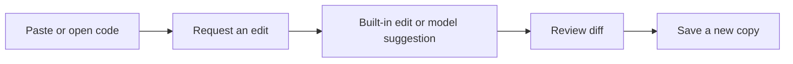
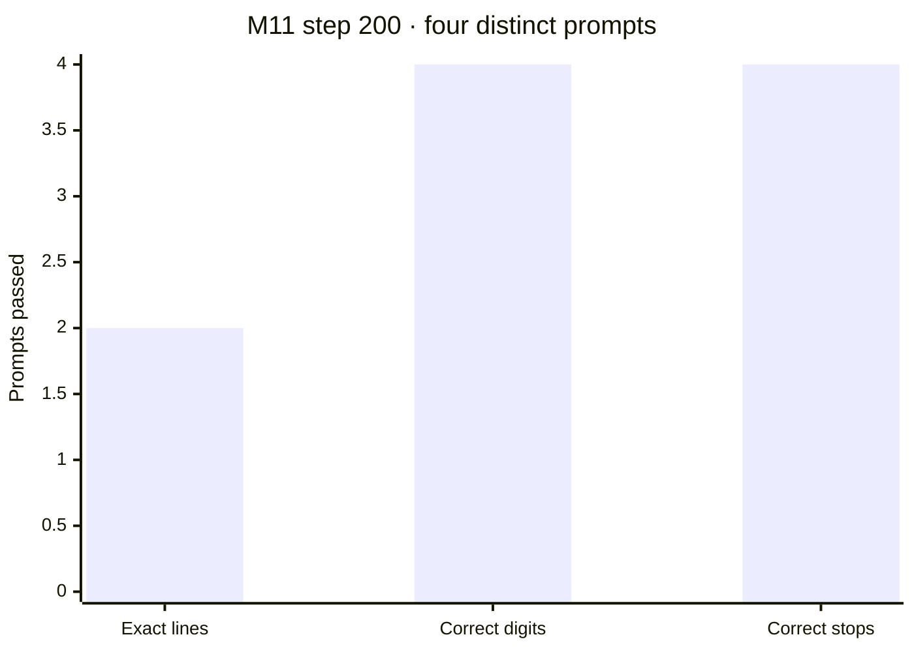

# Plex

Plex is a local coding assistant for code you supply. The working console can rename a variable in a supported JavaScript snippet, preserve quoted text, preview the diff, and save an edited copy. The 27M Plex Nano is the controlled research baseline. The separate 600M M11 checkpoint powers optional model suggestions.



## Try the local console

Get [PlexLocal.py](https://chatgpt.com/library?file_id=libfile_27db36ce5ff881918197a4d38e485c98&account_id=personal) and run `python PlexLocal.py` from its folder. At the Plex prompt, enter:

```text
paste
let value = 1;
console.log("value", value);
.end
rename value to count
diff
```

Use `save as "plex-demo.js"` to write a new copy, or `undo` to reverse the edit. The optional model path uses the existing WSL training environment and verified M11 weights. A model suggestion is shown for review when it returns code.

## What the checkpoint demonstrated



Both decoders agreed. The checkpoint copied the two training lines exactly. Both development prompts used the correct digit and ended cleanly, but generated `score` in place of `value`.

The verified console rename uses the built-in editor. The tested free-form rename sent to the 600M checkpoint returned EOS with empty output. Training is paused while development focuses on the local assistant.

## Development references

- [Master development roadmap](PLEX-MASTER-ROADMAP.md)
- [Project map](PROJECT-MAP.md)
- [Training workspace and historical runbooks](training/README.md)
- [M11 worker repair](https://github.com/keepithandy/plex-nano/pull/218)
- [License](LICENSE)
